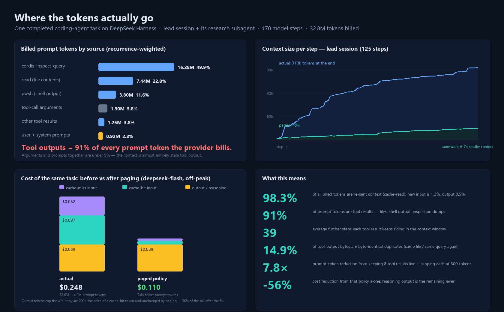

# Evidence: where the tokens actually go

This page documents the measurement behind MemAi's design. It is intentionally
separate from the benchmark: `bench/RESULTS.md` measures *the tool* on 14 tasks;
this document measures *the problem* on a real multi-agent coding session.

The short version: on a completed two-agent task, **32.8M tokens were billed,
98.3% of them were re-sent context, and 91.4% of prompt tokens were tool
results** — mostly file reads, shell output and inspection dumps that then rode
in the context window for dozens of further steps.

## 1. Dataset

| quantity | value |
| --- | --- |
| task | one completed coding task: build a host plugin, run it, write it up |
| agents | one lead agent + one spawned research subagent (in-process) |
| model steps | 170 (125 lead, 45 subagent) |
| session events decoded | 1,459 |
| tokens billed (provider usage events) | **32,770,369** |
| — uncached input | 411,429 |
| — cache-read input | 32,209,920 |
| — output | 149,020 |
| provider | DeepSeek (`deepseek-flash`), prompt caching automatic |
| prices used | off-peak $/1M: input miss 0.15 · cache hit 0.003 · output 0.60 |

Every figure comes from the provider-billed `usage` block attached to assistant
messages in the session logs, not from an estimate of "typical" usage. The
analysis scripts are not shipped with this repository (they are tied to the
harness that produced the logs); the method below is specific enough to
reimplement against any agent that records per-step usage.

## 2. Method

### 2.1 Decode the logs

Session logs are zstd-compressed JSONL: one event per line (`session/created`,
`user/message`, `assistant/message`, `tool/result`, `subagent/created`, …).
Decoding reconstructs, for every model step, the full visible context that was
sent: system prompt, conversation, and tool results. Provider usage on each
`assistant/message` event gives the billed token counts per step.

### 2.2 Recurrence-weighted attribution

A tool result is paid once when it arrives and then **again on every later step**
as part of the re-sent prefix. Attributing costs to the step where an item first
appeared therefore under-counts badly. Instead:

1. Walk the steps in order, maintaining the set of events visible at that step.
2. For each event, add its character count once for **every subsequent step it
   remains visible** (i.e. until eviction/compaction removes it).
3. Convert characters to tokens at the rate calibrated on this corpus
   (`chars / 3.7`, computed per session), then **scale each session's total to
   the provider's recorded prompt tokens** so the attribution shares sum to the
   real bill.
4. Attribute each event to its origin: `read(file contents)`, `pwsh(shell
   output)`, `cordis_inspect_query(inspection dumps)`, `tool-call arguments`,
   `other tool results`, `user + system prompts`.

This is a model of *when* tokens were billed, not a byte-exact replay of the
provider's tokenizer. It is fit to the billed totals, and the dominant term is
unambiguous (see the table below): tool output.

### 2.3 Counterfactual replay

To estimate the size of the prize, the same decoded logs are replayed under a
paging policy:

- keep only the **last 8 tool results** in the live context,
- cap each at **600 tokens**,
- replace older results with a ~200-character handle containing a page id, so
  the full text can be re-faulted in one call,
- leave the system prompt, conversation and final answer untouched.

The replay recomputes the visible prefix at every step and re-prices it with the
same tokenizer calibration and the same prices. It changes *what stays in
context*, not what the model decides, so it is an estimate of the mechanical
saving — not a claim that the agent would finish the task in the same number of
steps with the same answers.

## 3. Results

### 3.1 Attribution (recurrence-weighted)

| source | tokens | share |
| --- | --- | --- |
| inspection dumps | 16.28M | 49.9% |
| `read` (file contents) | 7.44M | 22.8% |
| shell output | 3.80M | 11.6% |
| tool-call arguments | 1.90M | 5.8% |
| other tool results (web, skill, grep, edit, write, …) | 2.28M | 7.0% |
| user + system prompts | 0.92M | 2.8% |
| assistant text | 0.05M | 0.1% |
| **tool results total** | **29.80M** | **91.4%** |

Arguments and prompts together are under 9%: the context is almost entirely
stale tool output.

### 3.2 The mechanics of the bill

| metric | value |
| --- | --- |
| share of billed tokens that are re-sent context (cache-read) | **98.3%** |
| share that is new input / output | 1.3% / 0.5% |
| average further steps each tool result rides in context | **~39** |
| tool-output bytes that are byte-identical repeats | 14.9% (266 results → 212 unique) |
| context size, first → last step (lead) | 4.1k → 310k tokens |
| cost of the task at off-peak prices | **$0.248** ($0.062 input miss + $0.097 cache hit + $0.089 output) |

### 3.3 Counterfactual: a paging policy

| scenario | prompt tokens | cost (off-peak) |
| --- | --- | --- |
| actual | 32.6M | $0.248 |
| last-8 tool results, 600-token cap, handles for the rest | **4.2M** | **$0.110** |
| reduction | **7.8×** | **−56%** |

The residual 36% of the bill is output/reasoning. Paging does not shrink what
the model writes; that is the second lever, addressed by giving agents structure
(pages, manifests, deltas) instead of raw material to reason over.

## 4. What this does — and does not — prove

**It does prove** that in this session the dominant cost was *repeated
transmission of tool output*, not the project bootstrap (the first model call was
~4k tokens). It also shows the two cross-agent multipliers: the subagent alone
billed 6.1M prompt tokens re-deriving facts its parent already had, and 14.9% of
tool-output bytes were exact duplicates.

**It does not prove** production savings. Limits, stated plainly:

- **One task, one provider, one price snapshot.** Prices change; peak pricing is
  2× off-peak. Token ratios are price-independent, dollars are not.
- **Attribution is a model** (recurrence weighting fit to billed totals), not
  ground truth about the provider's tokenizer.
- **The counterfactual assumes the policy is feasible.** Evicting a tool result
  only helps if the agent can re-fault it cheaply; the replay estimates the
  bytes saved, not the workflow change. A real A/B must show no accuracy
  regression.
- **The work was harness-specific.** The session contained large inspection
  dumps from a host-plugin API audit; a different task (mostly editing) will have
  a different mix, though the accumulation multiplier is general.
- **A/B in production is the missing experiment.** Run representative tasks with
  and without paging, record tokens, cache-hit rate and $/task. Success criteria:
  ≥5× fewer total tokens and ≥90% of shared-prefix tokens billed as cache hits,
  with no accuracy regression.

## 5. Reproduction sketch

The analysis is ordinary data work: decode JSONL events, reconstruct the
per-step visible set, attribute chars × recurrence, scale to billed totals,
then replay a retention policy. If you want to repeat it, log per request:

- `prefix_hash`, prompt tokens, cache-hit tokens, cache-miss tokens, output tokens;
- tool name, result bytes, and a stable id for each result;
- session id and agent id (locally only — never publish them).

Then run the same two calculations. The scripts that produced the figure here
are deliberately not part of the package because they depend on harness-private
log paths; the method is the deliverable.

See also: [`design.md`](design.md) for how the numbers shape the architecture,
[`../bench/RESULTS.md`](../bench/RESULTS.md) for the measured tool benchmark,
and [`faq.md`](faq.md) for the "isn't this just RAG?" question.
